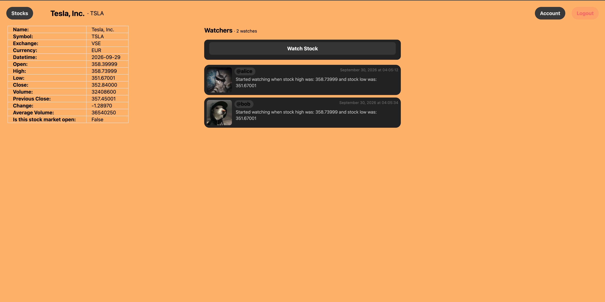

# Stock Tracker

A Flask web application for looking up market data, creating an account, and following stocks with other users. It retrieves live quote information from Twelve Data and stores accounts, watch activity, and optional profile pictures in MongoDB.

Author: Pranav Khatri

This project was developed at the University of Maryland for **CMSC388J: Building Secure Web Applications** during the **Spring 2025** semester.

## Demo

Demo: [https://youtu.be/GN6Y_PFgN0g?si=40hSURAGKniO5N1o](https://youtu.be/GN6Y_PFgN0g?si=40hSURAGKniO5N1o)



## Highlights

- Look up stocks by ticker and view current quote data, including open, high, low, volume, and percent change.
- Create an account, sign in securely, and manage a username or profile picture.
- Follow a stock and see other users who are watching it.
- Hash passwords with bcrypt, validate forms, protect submissions with CSRF tokens, and require authentication for account actions.

## Tech stack

Python, Flask, Jinja, Flask-Login, Flask-Bcrypt, MongoDB, Twelve Data, and Tailwind CSS.

## Run locally

Prerequisites: Python 3.10+, Node.js (only if rebuilding CSS), and a MongoDB database (local or Atlas).

```bash
git clone <your-fork-or-repository-url>
cd stock-tracker
python3 -m venv .venv
source .venv/bin/activate
pip install -r requirements.txt
cp .env.example .env
```

Edit `.env` with the following values:

- `SECRET_KEY`: a long random string for Flask sessions. For example: `python3 -c "import secrets; print(secrets.token_hex(32))"`.
- `MONGODB_URI`: a connection string for your own MongoDB database. [MongoDB Atlas](https://www.mongodb.com/products/platform/atlas-database/getting-started) provides a guided setup; allow your development IP and create a database user before copying its connection string.
- `TWELVE_DATA_API_KEY`: create a free Twelve Data account and copy a key from the [API dashboard](https://twelvedata.com/account/api-keys).

Then start the development server:

```bash
flask --app run run --debug
```

Open `http://127.0.0.1:5000` in your browser. `.env` is ignored by Git; never commit it or share its contents.

### Rebuild CSS (optional)

The compiled stylesheet is included, so this is only necessary after changing `flask_app/static/source.css`.

```bash
npm install
npm run build:css
```
